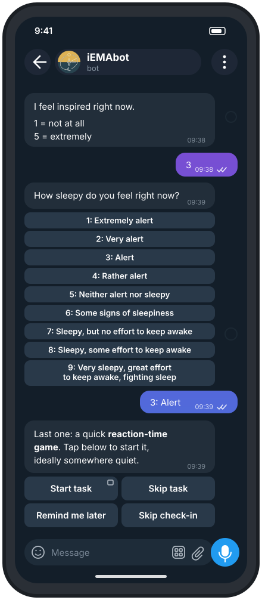
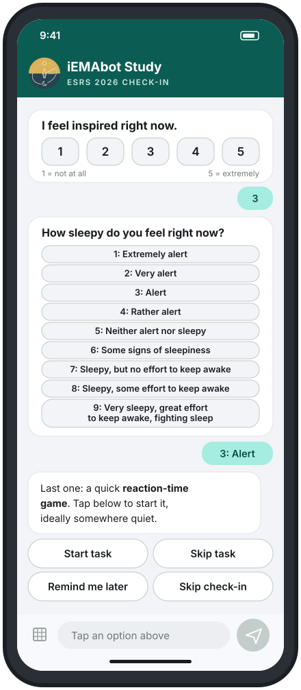

	
	 
	<a href="https://demo-esmira.kl.ac.at/">[Demo]</a>
	<a href="https://esmira.kl.ac.at/?about">[Screenshots]</a>
	<a href="https://github.com/KL-Psychological-Methodology/ESMira/wiki">[Wiki]</a>
	<a href="https://github.com/andreifoldes/iEMAbot/discussions">[Discussions]</a>

This is the web server module for [ESMira](https://github.com/KL-Psychological-Methodology/ESMira). It is responsible for providing studies to the [ESMira apps](https://github.com/KL-Psychological-Methodology/ESMira-apps), saving participant's data as well as providing an interface for designing studies and accessing data. If you want to use ESMira to run your own studies, you need to set up your own ESMira server. For more information follow our [step-by-step guide](https://github.com/KL-Psychological-Methodology/ESMira/wiki/Setting-up-a-server).
For more general information about ESMira have a look at the [main Readme](https://github.com/KL-Psychological-Methodology/ESMira).

	
	&nbsp;&nbsp;&nbsp;
	
	 
	<em>One study, two ways to answer: the same check-in as a Telegram conversation (left) and in the installable participant web app (right). Illustrative mockups.</em>

## :handshake: Contributing and discussion
This repository is the iEMAbot fork of the ESMira web server (study design interface, data collection and the participant PWA). Its [documentation](https://andreifoldes.github.io/iEMAbot/) describes what has changed and what each feature does.

**Questions, ideas and feedback are welcome in [Discussions](https://github.com/andreifoldes/iEMAbot/discussions).** Ask how something works, propose a feature, or show the study you built with it. Not sure whether something is a bug? Start a discussion and we will work it out together.

**Pull requests are welcome too.** Fixes, features, tests and documentation improvements all help.
1. Fork the repository and branch from `main`.
2. Try your change with the one-command demo, which builds the image, creates an admin and a demo study, and checks both the participant app and the researcher dashboard: `scripts/demo/demo-up.sh` (details: [Demo and verification](https://andreifoldes.github.io/iEMAbot/deployment/demo-and-verification)).
3. Use [Conventional Commits](https://www.conventionalcommits.org/) for your commit messages (for example `fix(pwa): ...` or `docs(website): ...`).
4. Open a pull request against `main` and describe what changed and how you tested it. A short draft PR to talk an idea through is fine.

The documentation site lives in `website/` and is deployed from `main`. A security check scans every push and pull request for private details, so please never include credentials, server addresses, study access keys or participant data in code, docs or discussions. If you think you have found a security vulnerability, do not post it publicly: open a discussion asking for a private way to share it, without including the details.

## :link: Resources
- [Main repository](https://github.com/KL-Psychological-Methodology/ESMira)
- [Website](https://esmira.kl.ac.at/?about)
- [Wiki](https://github.com/KL-Psychological-Methodology/ESMira/wiki)
- [Discussions](https://github.com/andreifoldes/iEMAbot/discussions)
- [iEMAbot documentation](https://andreifoldes.github.io/iEMAbot/)
- [Demo Server](https://demo-esmira.kl.ac.at/)
- [Help development](https://github.com/KL-Psychological-Methodology/ESMira/wiki/Help-development)