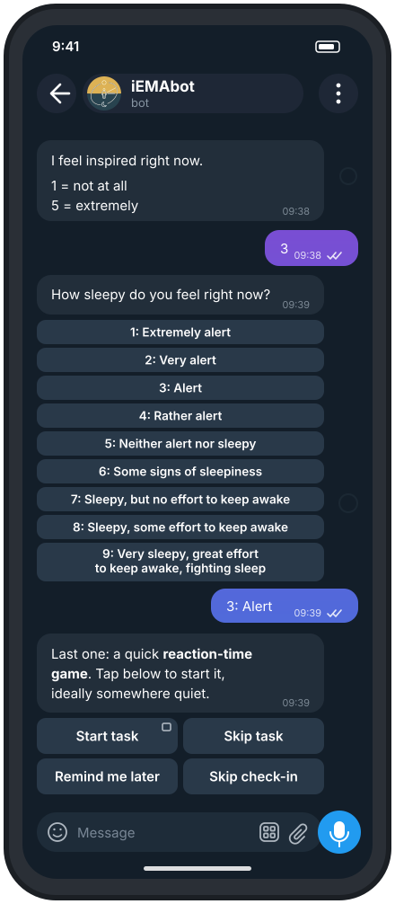
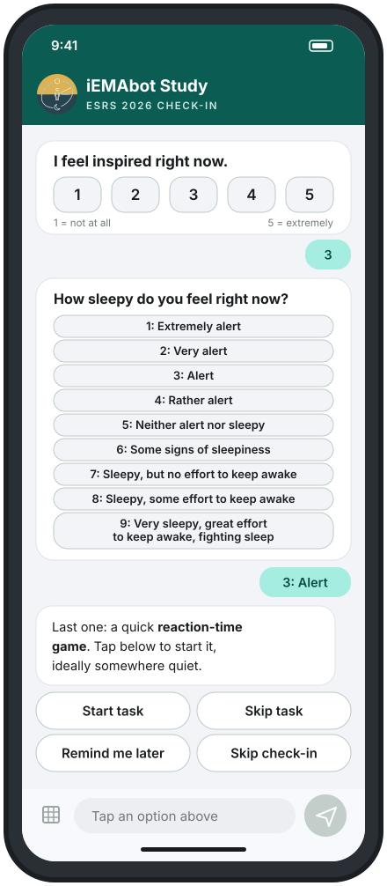
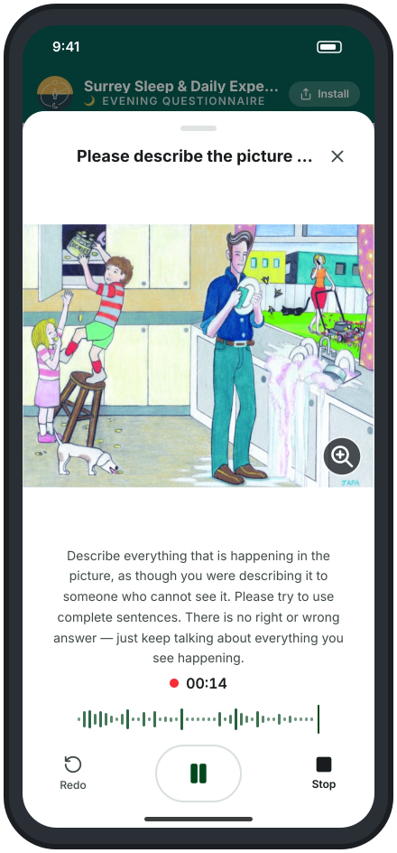
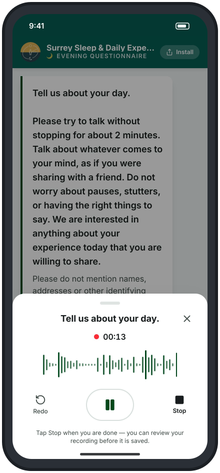

<p align="center">
	
	<br>
	<a href="https://demo-esmira.kl.ac.at/">[Demo]</a>
	<a href="https://esmira.kl.ac.at/?about">[Screenshots]</a>
	<a href="https://andreifoldes.github.io/iEMAbot/">[Wiki]</a>
	<a href="https://github.com/andreifoldes/iEMAbot/discussions">[Discussions]</a>
</p>

**iEMAbot** is an open-source framework for ecological momentary assessment (EMA) in circadian and sleep research, developed at the Surrey Sleep Research Centre and the UK Dementia Research Institute Care Research & Technology Centre. It is a fork of [ESMira](https://github.com/KL-Psychological-Methodology/ESMira), the open-source experience-sampling platform from Karl Landsteiner University, and keeps ESMira's study designer, data collection and server.

**Why we forked.** Understanding how sleep and circadian rhythms shape daytime functioning takes repeated self-report and task data collected in daily life. Dedicated EMA platforms are often costly and complex (subscriptions, proprietary apps, technical infrastructure), and unfamiliar app interfaces reduce engagement and adherence, especially in older or cognitively vulnerable people. ESMira gave us an open, self-hostable base. We forked it to add what our studies need and upstream does not offer: delivery through a familiar chat-style interface; interactive web tasks embedded in the check-in, such as cognitive tests from [m2c2](https://m2c2.org) ([PVT](https://andreifoldes.github.io/m2c2-assessments/assessments/pvt-ba/?show_end_screen=false), [SART](https://andreifoldes.github.io/m2c2-assessments/assessments/sart2/?show_end_screen=false) and [more](https://andreifoldes.github.io/m2c2-assessments/)), custom affect measures ([Affective Slider](https://andreifoldes.github.io/novel-assessments/affective-slider/), [MoodLine](https://andreifoldes.github.io/novel-assessments/moodline-os/)) and [audio measures](https://andreifoldes.github.io/novel-assessments/reflection/), all with live demos you can try in your browser; and flexible prompt logic that fires at the right moment in the sleep-wake cycle, driven by wearable events and by timings.

**Goals**
- **Meet participants where they are.** The primary route is an installable web app (no app store) with a chat-style interface. Studies that need more can add an Android app (Beta) for phone-sensor data such as activity, light and app usage, or a Telegram bot (Beta) for high-priority notifications and delivery inside an app participants already use. The channel layer is built to be extended to WhatsApp and SMS.
- **Prompt at the right moment.** Flexible "if this, then that" scheduling (time-contingent, event-contingent and adaptive designs, multi-point daily sampling), including prompts triggered by wearables and nearables, for example when a Withings sleep sensor reports that someone got out of bed, with a time fallback if no event arrives. We currently focus on Withings devices and Google Health, which also carries Fitbit and Pixel Watch data. Other OAuth-based providers such as Oura should be straightforward to add: a provider is one class behind a common interface.
- **Go beyond questionnaires.** Cognitive tasks ([M2C2](https://andreifoldes.github.io/m2c2-assessments/), a [psychomotor vigilance test](https://andreifoldes.github.io/m2c2-assessments/assessments/pvt-ba/?show_end_screen=false)), [voice memos](https://andreifoldes.github.io/novel-assessments/reflection/) and [typing-dynamics capture](https://andreifoldes.github.io/novel-assessments/reflection/?mode=text), alongside validated sleep and alertness scales. Each link opens a live demo in your browser.
- **Keep it affordable and under your control.** A self-hosted server that runs on a low-cost VPS or your institution's own cloud tenant, so data stay on infrastructure you manage.
- **Be accessible.** WCAG 2.2 AA is a deploy gate for the participant app.
- **Stay open.** Everything is AGPL-3.0, documented, and built for community extension.

Several of these are early. [Current status](https://andreifoldes.github.io/iEMAbot/current-status) lists, claim by claim, what is shipped, partial or not yet built, and the [documentation](https://andreifoldes.github.io/iEMAbot/) covers setup and study design. For upstream ESMira, see its [main Readme](https://github.com/KL-Psychological-Methodology/ESMira) and [server setup guide](https://github.com/KL-Psychological-Methodology/ESMira/wiki/Setting-up-a-server).


<p align="center">
	
	&nbsp;&nbsp;
	
	&nbsp;&nbsp;
	
	&nbsp;&nbsp;
	
	<br>
	<em>One study, several ways to answer: the same check-in as a Telegram conversation and in the installable participant web app, then two voice tasks in the web app, a picture description and a daily reflection voice diary. Illustrative mockups. See <a href="https://andreifoldes.github.io/iEMAbot/pwa/question-types#voice-memos">Voice memos</a>.</em>
</p>


## Run your own server
Your lab can run iEMAbot on its own Linux server, so study data stays with you. Point a domain name at the server, then run:

```bash
curl -fsSL https://raw.githubusercontent.com/andreifoldes/iEMAbot/main/deploy/selfhost/install.sh | bash
```

It asks for the domain, a contact email and an admin name, sets up HTTPS, backups and everything else, and tests the result. Read the [self-hosting guide](https://andreifoldes.github.io/iEMAbot/deployment/self-hosting) for updates, backups, running behind an existing web server, and moving servers.

## Contributing and discussion
This repository is the iEMAbot fork of the ESMira web server (study design interface, data collection and the participant PWA). Its [documentation](https://andreifoldes.github.io/iEMAbot/) describes what has changed and what each feature does.

**Questions, ideas and feedback are welcome in [Discussions](https://github.com/andreifoldes/iEMAbot/discussions).** Ask how something works, propose a feature, or show the study you built with it. Not sure whether something is a bug? Start a discussion and we will work it out together.

**Pull requests are welcome too.** Fixes, features, tests and documentation improvements all help.
1. Fork the repository and branch from `main`.
2. Try your change with the one-command demo, which builds the image, creates an admin and a demo study, and checks both the participant app and the researcher dashboard: `scripts/demo/demo-up.sh` (details: [Demo and verification](https://andreifoldes.github.io/iEMAbot/deployment/demo-and-verification)).
3. Use [Conventional Commits](https://www.conventionalcommits.org/) for your commit messages (for example `fix(pwa): ...` or `docs(website): ...`).
4. Open a pull request against `main` and describe what changed and how you tested it. A short draft PR to talk an idea through is fine.

The documentation site lives in `website/` and is deployed from `main`. A security check scans every push and pull request for private details, so please never include credentials, server addresses, study access keys or participant data in code, docs or discussions. If you think you have found a security vulnerability, do not post it publicly: open a discussion asking for a private way to share it, without including the details.

## Maintainers
- **Tamas Andrei Foldes**, lead developer, Surrey Sleep Research Centre, University of Surrey. [ORCID 0000-0002-0623-9149](https://orcid.org/0000-0002-0623-9149). For questions, use [Discussions](https://github.com/andreifoldes/iEMAbot/discussions).

## Staying up to date
Labs running their own iEMAbot can find out about new releases in two ways:
- **In the dashboard:** an administrator sees an *A new version is available* banner on the admin home page whenever a newer stable release has been published. Then run `./update.sh` on the server (or, on an install without Docker, use the one-click update under **Server settings**).
- **By notification:** on GitHub choose **Watch → Custom → Releases** on [this repository](https://github.com/andreifoldes/iEMAbot), or subscribe to the [releases feed](https://github.com/andreifoldes/iEMAbot/releases.atom) in any feed reader.

## Resources
- [Main repository](https://github.com/KL-Psychological-Methodology/ESMira)
- [Website](https://esmira.kl.ac.at/?about)
- [Wiki (iEMAbot documentation)](https://andreifoldes.github.io/iEMAbot/)
- [Discussions](https://github.com/andreifoldes/iEMAbot/discussions)
- [Demo Server](https://demo-esmira.kl.ac.at/)
- [Help development](https://andreifoldes.github.io/iEMAbot/help-development)