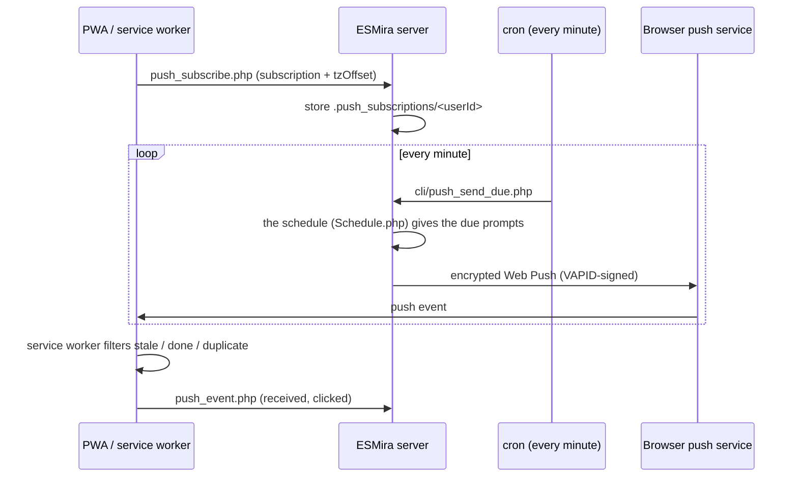

# Web Push notifications

<span className="status status--shipped">Shipped</span> · fork-only

Upstream's web client has no reminders. This fork adds server-side **Web Push** so the installed PWA can be
nudged at the times defined by the study's [schedule](../scheduling.md).



## Setup

1. **Generate VAPID keys** once per server:
   ```bash
   php cli/generate_vapid.php          # add --force to rotate
   ```
   This writes `vapid_public_key`, `vapid_private_key` and `vapid_subject` (default `mailto:noreply@esmira`)
   into the server config. Set a real contact address as the subject for production.
2. **Install dependencies:** the Dockerfile installs `gmp`, `mbstring`, `curl` and Composer's
   `minishlink/web-push` (`^9.0`).
3. **Cron:** the image installs a per-minute job running `cli/push_send_due.php`
   (see [Docker and cron](../../deployment/docker-and-cron.md)).
4. **Enable per study:** tick *Web Push* in the study's Push panel (`webPushEnabled`).

The public key reaches the PWA through `api/studies.php`.

## Subscription flow

`web-pwa/src/lib/push.ts` waits for the service worker (up to 8 s), recreates the subscription if the
server's application key changed, and posts it to `push_subscribe.php`. The server stores
`{userId, subscription, tzOffset, created}` under `.push_subscriptions/<userId>`. The timezone offset comes
from `Date#getTimezoneOffset()` and is refreshed on each visit with permission granted, so scheduling follows
the participant's local clock.

### Asking again while notifications are off {/* #daily-nudge */}

A participant can reach the study without notifications: they declined the browser's or Android's dialog, tapped
*Not now* at onboarding, or blocked them later. While the study sends them notifications (the research team's
switch for the channel is on, they have not switched notifications off in Settings, and the schedule prompts) but
the device does not allow them, the app shows a **Notifications are off** card above the questionnaire list, at most
once a day (`web-pwa/src/lib/notificationNudge.ts`, the local calendar day, per study and participant). What it
offers depends on what the system still allows:

| State | Card |
| --- | --- |
| Permission undecided (web), or Android can still show its dialog | *Turn on notifications* shows the system dialog. |
| Blocked: the browser no longer asks, or Android was declined twice | Web: how to allow them in the browser's (or, for an installed iPhone app, the iPhone's) settings, and *Try again*. Android: *Open settings* opens the app's notification settings (`Reminders.openNotificationSettings`). |
| iOS Safari before the app is on the Home Screen (no web push) | How to add it to the Home Screen, with the invite code to type in there. |

Declining at onboarding counts as that day's ask, and *Not now* hides the card until the next day. When the app returns to the foreground the permission is read again,
so allowing notifications in the settings plans (Android) or subscribes (web) at once. Researchers can turn the card
off under **Study settings → Participant permissions** (`notificationNudge`, on by default).

## How the scheduler decides what to send

`PushSender::run` iterates studies with `webPushEnabled` and, per subscriber, keeps a state file
(`cursor`, `sent`, `sensor`). The **first run sets the cursor to "now"**: there is no backfill. Texts are
taken from the study in the participant's language (recorded at subscribe time: the language the app
received the study in, which follows the researcher's [app language setting](../../pwa/overview.md#interface-language)
when the study has been translated into it, else the browser's). The server's own wording is translated too,
see [Language of the fixed wording](#notification-language).

| Source of an occurrence | Behaviour |
| --- | --- |
| Fixed signal time | `startTimeOfDay` in participant-local time. |
| Random signal window | `frequency` times, one per equal block of `startTimeOfDay`–`endTimeOfDay`, on whole minutes. Drawn deterministically per participant and day (FNV-1a of study, participant, signal and date), so the sender, `push_status.php` and the Android app all get the same times. `minutesBetween` is not applied. |
| Reminders | `reminder_count` repeats, each `reminder_delay_minu` after the base time (5 minutes when the field is absent, the model default). |
| "Window opened" | For questionnaires with `completableAtSpecificTime` and no signals. |
| Deadline text | " Complete by HH:MM." (24-hour, end of day as 23:59) when `notificationIncludeDeadline` is set. |

Honoured schedule fields: `dailyRepeatRate`, weekdays, `dayOfMonth`, `skipFirstInLoop`, `startDayOne` (when
stored), `durationStartingAfterDays`, `durationPeriodDays` (counted from enrolment, as for availability),
`durationStart`, `durationEnd`. Only actions of type 1 (invitation) and 3 (simple notification) are pushed;
a trigger with only in-app messages notifies nobody. **Event triggers are not processed.**

## One notification on every channel {/* #channels */}

<span className="status status--shipped">Shipped</span> · fork-only

The browser PWA (web push) and the Android app (alarms planned on the phone) show **the same notification at
the same minute**. The rules live in one specification with two implementations held together by shared
fixtures:

| Part | Server (web push) | Android app |
| --- | --- | --- |
| Content and look: title, body, deadline text, coalesced text, icon, badge, accent | `NotificationSpec.php` | `web-pwa/src/lib/notificationSpec.ts` |
| Schedule: which prompts and reminders fall due when | `backend/schedule/Schedule.php` | `web-pwa/src/lib/schedule.ts` (line-by-line port; see [Scheduling](../scheduling.md)) |
| Delivery | `PushSender` → service worker | `notificationPlan.ts` → the app's `Reminders` plugin (`ReminderStore` exact alarms, `ReminderNotifier` posts); `NudgeWorker` polls `native_pending.php` for wearable prompts only and posts through the same `ReminderNotifier` |
| Parity test | `NotificationParityTest.php`, `ScheduleTest.php` | `notificationParity.test.mts`, `schedule.test.mts` |

Both run `test/fixtures/channels/notifications.json` and `schedule.json`; a rule changed on one side only fails a test suite.

| Rule | Value |
| --- | --- |
| Title | The check-in's **notification title** (set in the Schedule panel), else the questionnaire's title, else the study's, else "iEMAbot". |
| Body | The check-in's notification text (trimmed), else "You have a questionnaire to complete."; with *Complete by* the window's close is added. |
| Several due in the same minute | One notification under the study title: "You have N questionnaires to complete." |
| Already done | Dropped by the same checks as the [service worker](#suppressing-reminders) (Android: when the plan is refreshed on app open and after each completion). |
| Icon / badge | `pwa-192x192.png` / `badge-96x96.png` (the figure from the logo); Android ships copies as `ic_notification_large` / `ic_stat_esmira`. |
| Stacking | At most one iEMAbot notification on screen: each new one replaces the last and alerts again (web: tag `esmira-reminder` with `renotify`; Android: `ReminderNotifier` posts every notification, planned or server-sent, under the same tag and id). |
| Shown once | The same occurrence (`type:qid:time`) is never shown twice within 48 hours (web: the service worker's IndexedDB ledger; Android: `ReminderStore.markShown`). |
| Accent | `#075E54`, the PWA's theme colour. |
| Language | Researcher-written text: the language the participant sees the study in. The fixed wording below: see [Language of the fixed wording](#notification-language). |

### Language of the fixed wording {/* #notification-language */}

Some notification text is not written by the researcher: the default body, the counted summary ("You have N
questionnaires to complete."), "Complete by HH:MM.", the study-complete message when the researcher left it empty,
and the welcome push sent when a participant turns notifications on. These come from the participant app's translation files,
`src/locales/pwa/<code>.json` (the `pwa_push_*` keys; the study-complete and welcome text are used only by the
server), through `backend/notifications/NotificationText.php`. The language is, in order:

1. the study's **Participant app language (web)** setting, the language the app itself shows;
2. the app language the participant's device reported when it subscribed (`uiLang`), for *Automatic*;
3. the server's default language;
4. English.

English is also the fallback for any string a language has not translated, so a notification is never empty or
shown as a key. Android reminders planned on the phone use the same keys through the app's own translation layer.
Text the researcher wrote (titles, bodies, the study-complete text) is shown as written, in the study's language
variant.

Researchers write the content once, per check-in, in the Schedule panel; the [researcher panel](#researcher-panel)
shows the resulting notifications. Remaining platform difference: Android needs the app to be opened within the
7-day planning window to roll it forward.

### Switching notifications off {/* #switches */}

| Who | Where | Effect |
| --- | --- | --- |
| Research team, per study and channel | Push notifications panel: *Enable web push reminders (web)* (`webPushEnabled`, off by default) and *Enable notifications in the Android app* (`androidNotificationsEnabled`, on by default) | Web: `PushSender` skips the study. Android: the app stops planning and cancels what it planned the next time it opens; `native_pending.php` answers `active: false`. |
| Participant | The app's Settings → Notifications switch (web app and Android app) | `api/notification_prefs.php` stores a `.notifications_off/<userId>` marker. `PushSender` sends nothing to them (the cursor still advances, so switching back on brings no backlog), `native_pending.php` answers `active: false, notificationsOff: true`, the Android app cancels its plan and the shown notification. The participant stays in the study. `push_status.php` reports `notificationsOff`, so another device of the same participant follows the switch. A choice made offline is sent when the app next opens. |

Pushes are **coalesced to one per participant per run**, share the constant tag `esmira-reminder` with
`renotify`, and a 48-hour ledger keyed `type:qid:ts` prevents duplicates.

## Suppressing reminders {/* #suppressing-reminders */}

A reminder for something already done is noise, so it is suppressed on both sides.

**Server:** the schedule knows every completed questionnaire from the uploads (`ParticipantVariableStore`,
`@completions`): a check-in that is done (by its limit) is not prompted, and its reminders stop once the
questionnaire has been completed since its window opened.

**Service worker (`sw.ts`)** applies the schedule's rule to the device's completions and drops an item when any of
these hold:

- its deadline has passed;
- the questionnaire was completed since the window opened, or this window was;
- its limit is *once in the study* and it was completed before;
- its limit is *once per day* and it was completed in the window's study day;
- it was already shown in the last 48 hours.

If nothing remains, **no notification is shown**. Completions are read from an IndexedDB mirror
(`completionMirror.ts`) because the worker cannot read `localStorage`. If several items remain, the body uses
a `%d` count template.

## Researcher panel

Requires **write** permission. Source: `sections/pushNotifications.tsx`.

| Element | Detail |
| --- | --- |
| Enable toggles | Per channel: `webPushEnabled` (web app), `androidNotificationsEnabled` (Android app). See [Switching notifications off](#switches). |
| Subscribers | Count, with a warning if no VAPID key is configured. |
| Reach | Installed-as-PWA vs in-browser counts, and device split (mobile/tablet/desktop) from `client_info.php`. |
| Sender heartbeat | Warns if the cron sender last ran more than 180 s ago, or never. |
| What participants will see | The first three days after enrolment, computed by `NotificationPreview` from the same code that sends them: day, time, title, text and icon, identical on every channel. Random times are drawn for a sample participant. Shown with or without web push. |
| Funnel | Per channel. Web: sent (accepted by the push service) → arrived (service worker) → opened. Android: sent (alarms handed to the phone, plus wearable prompts fetched) → arrived (shown; reported when the app is next opened) → opened. Failed, 14-day series, per-participant table (first 100) with each participant's channel. |
| Welcome notification | How many participants confirmed at onboarding that the welcome notification arrived, and how many said it did not (`welcome_confirmed` / `welcome_missed` from `push_event.php`); per participant in the table, with a warning when it did not arrive. |
| Switched off | How many participants turned notifications off in the app; marked per participant in the table. |
| Test push | To all subscribers, or to one participant (not to one who switched notifications off). |
| Withdraw | Per participant in the table, or by participant id below it (for Android-app participants, who never appear in the push funnel). See [Leaving the study](#leaving-the-study). |
| Withdrawn participants | Who left, when, and whether they signed out in the app or were withdrawn by the research team. Shown for every study, with or without web push. |

## Participant self-test

During onboarding, and from *Settings → Notifications not working?*, the PWA calls `push_test.php`, which
sends a server-generated welcome push to the caller's own subscription (falling back to a local
notification). The onboarding then asks "Did the notification arrive?".

## Leaving the study {/* #leaving-the-study */}

Nothing may reach a participant who has left. The server keeps a per-participant **withdrawal marker**
(`studies/<id>/.withdrawn/<userId>`, in `backend/notifications/ParticipantWithdrawals.php`) that every
sender checks:

| Who | What happens |
| --- | --- |
| Participant signs out in the PWA or the Android app | The app first posts `push_subscribe.php` with `unsubscribe: true` (the subscription and its cursor state are deleted at once) and then the `quit` event to `datasets.php`, both bounded to a few seconds so a dead connection cannot block the reset. Then it unsubscribes the browser, cancels the Android app's alarms and background poll, and wipes the device. |
| `quit` event arrives (from any channel, including Telegram's `/stop`) | `CreateDataSet` sets the marker and drops the participant's push subscription, push state and native poll state. |
| Researcher clicks **Withdraw** | Same as a `quit` event (`WithdrawParticipant`), for participants who uninstalled without signing out: the server cannot see an uninstall, and Chrome keeps a subscription alive when a PWA is removed without clearing its data. |
| While withdrawn | `PushSender` skips (and deletes) any subscription for the participant, `push_subscribe.php` refuses a new one (`errorCode` 410), `native_pending.php` answers `active: false, withdrawn: true` so the Android poll cancels itself and takes down shown notifications, the chat dispatcher leaves their binding alone, and `push_status.php` reports `withdrawn: true`, on which the app shows "You have left …" and resets the device, clearing the reminders the Android app scheduled itself. |
| `joined` event arrives | The marker is removed, so re-enrolling with the same participant id works as before. |

The marker lives in the study folder, so backups carry it and deleting the study removes it. **Reset study**
does not clear it (nor the push folders).

Still not covered: a PWA removed from the home screen while Chrome kept its data, and whose participant
never tells anyone. The push service keeps accepting those pushes, so the server cannot tell them from an
installed app that is being ignored; the per-participant funnel (sent, arrived, opened) is the place to spot
them, and **Withdraw** stops them. Reminders the Android app scheduled on the device stop as soon as the app
is opened (or at once on sign-out); until then the OS fires what the app had planned, at most seven days ahead.

## Failure handling

After a send, subscriptions answering HTTP **404/410** are deleted. Other failures are logged as `failed`
events in `.push_events` (JSONL).

## Known limitations

- **Welcome-push answers are discarded.** `push_event.php` accepts `welcome_confirmed` / `welcome_missed`, but
  `PushEvents` persists only `sent`, `failed`, `received` and `clicked`.
- **Suppression on the server is study-wide**, not per questionnaire.
- **Reliability is the platform's.** iOS requires installing to the Home Screen; Android battery
  optimisation can delay delivery. The PWA's own help text recommends the native ESMira app for the most
  reliable reminders.
- **Telemetry has no separate consent step.** Push funnel and client-info events are recorded for any
  subscribed participant.
