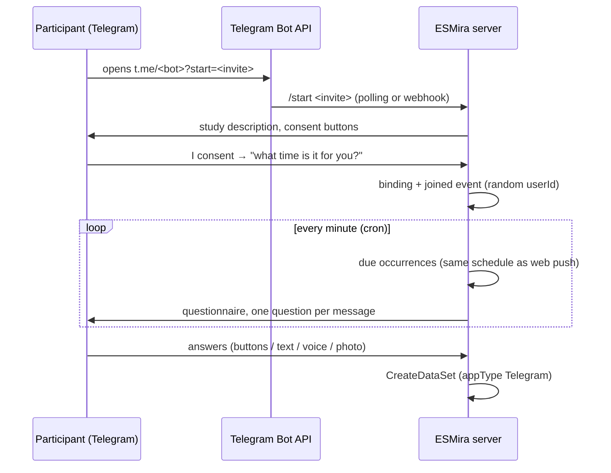

# Chat channels (Telegram)

Partial · fork-only · implemented and covered by tests, not yet run against a live bot in a study

Besides the [web PWA](../pwa/overview.md), a study can be answered **inside Telegram**. One bot serves the
whole ESMira server. Researchers switch Telegram on per study and share an invite link. The questionnaire then
runs as a conversation: one message per question, answered with buttons or typed replies. Answers are saved
through the same path as the apps (`CreateDataSet`), so the CSV has the same columns as the web app, with
`appType` set to `Telegram`.

## Setup

1. **Create a bot.** Talk to [@BotFather](https://t.me/BotFather) in Telegram, send `/newbot` and copy the token.
2. **Give ESMira the token.** As a server admin, go to *Server settings → Messaging channels* and paste it.
   The token is checked with Telegram, stored in the server config, and never shown again. The same can be
   done on the server with `php cli/telegram_setup.php set-token`, which reads the token from stdin.
3. **Set the public base URL** (for example `https://ema.example.org/esmira/`). Images in questions and the
   web handoff page (see below) are linked from it. The handoff needs `https://`.
4. **Pick a transport.**
   - **Polling** (the default) fetches updates from Telegram once a minute. It works behind firewalls and with
     internal TLS certificates.
   - **Webhook** has Telegram call `api/channel_webhook.php?channel=telegram`. It needs a certificate that
     Telegram trusts and a server Telegram can reach.
5. **Enable Telegram in the study.** Tick *Telegram* in the study settings, or open the study's *Telegram*
   section. There you also find the invite link with a QR code, per-participant links, and a compatibility
   report for the study's questions.

Two cron jobs run every minute (see [Docker and cron](../deployment/docker-and-cron.md)):
`cli/channels_dispatch.php` opens questionnaires when they are due, and `cli/telegram_poll.php` receives
updates. The poller does nothing when no bot is set up or the webhook transport is selected.

## Participant journey

- **Joining.** The invite link carries the study (and access key). A per-participant invite can also carry
  a researcher-assigned participant id. Such a link works once and expires after 60 days, and a participant id
  that is already connected to a chat cannot be taken over by a forwarded link. Otherwise ESMira generates a random user id, exactly like the PWA. The
  participant's local time is asked once. Tapping the suggested time keeps the server's time zone and stays
  correct across daylight-saving changes. A typed time gives a fixed offset, which can be updated with
  `/timezone`.
- **Prompts.** Signal times, random windows, reminders, completion windows and sensor triggers are computed by
  the same code as [Web Push](./web-push.md) (`notifications/DueOccurrences.php`). When a questionnaire is due,
  the bot sends it as a conversation. If another one is still open, the new one waits in a queue. A session
  closes when its completion window ends, or after three hours when the questionnaire has no window. A newer
  occurrence of the same questionnaire replaces an unfinished one. Questions that failed to arrive are re-sent
  a minute later.
- **Saving.** Answers that cannot be saved right away (for example while a study is locked) wait in a
  per-participant outbox and are retried every minute, so nothing is lost and nothing is saved twice.
- **Commands.** `/checkin` lists what can be answered now. These are the queued questionnaires plus anything
  open on demand, using the same availability rules as the PWA. `/cancel` stops the current questionnaire,
  `/timezone` updates the participant's time zone, `/stop` leaves the study (it sends a `quit` event), and
  `/help` lists the commands.

## Question types in chat

| ESMira type | In Telegram |
| --- | --- |
| text (display) | message |
| text_input, number | typed reply (min/max length, whole vs decimal number) |
| binary | two buttons with the item's labels → `0` / `1` |
| likert | numbered buttons, end labels in the text → `1…steps` |
| list_single | one button per option. With *other*, the last option asks for free text → `name~other` |
| list_multiple | ✅ toggle buttons and *Done*, edited in place → `name~1…N` |
| date | *Today* / *Yesterday* buttons or a typed date |
| time, duration | typed (`23:30`, `7:15am`, `11pm` / `7h 30m`, `1:15`, `90`). Durations are stored as minutes, as on web |
| image, video, share | photo or link button |
| dynamic_input | one sub-input per questionnaire, rotating (`name~index`) |
| photo, file_upload | the participant sends a photo or file, stored as the item's file |
| record_audio | a voice message, stored as the item's audio. *Skip* reveals a paired record_keystrokes fallback |
| location | Telegram's *share location* button → `lat,lon` |
| countdown | message with *Continue* |
| va_scale | slider in a Telegram Mini App (web handoff). Without handoff: 0–100 buttons in steps of 10 |
| record_keystrokes | keystroke-logging writer in a Mini App. Without handoff: a plain typed answer (`~capture_mode = chat`) |
| webapp, or text with a link (cognitive tasks) | the task in a Mini App, with trial rows saved to *Cognitive Trials*. Without handoff: skipped with a note |
| ambient_light, app_usage, battery_level, bluetooth_devices, compass, noise_level | not available (no sensors). Skipped |

Relevance supports the same single comparison as the PWA (`name == value`, `!=`, `>=`). Branching, answer
encoding and the *other, please specify* convention are kept identical to the web app by shared test
fixtures (`test/fixtures/channels/`) that run against both the PHP engine and the PWA.

### Web handoff

Items that need a real UI open `pwa/handoff.html`, a single-item page of the PWA. It reuses the same
components as the web app (VAS, keystroke recorder, cognitive task iframe). In Telegram it opens as a Mini App
inside the chat. On channels without web views it would open as a plain link. The link carries an HMAC-signed
token bound to that participant, questionnaire session and item, and it expires after six hours. Once the
item is answered the token is worthless, because the chat has moved on. Turn this off per study with
*allowHandoff*. The chat approximations listed above are then used instead.

## Privacy

- The Telegram chat id is never stored in clear. Each binding holds it encrypted (libsodium secretbox, key
  `channels_secret_key`), and the chat → participant lookup uses an HMAC of it. Datasets only contain the
  random ESMira user id.
- **Telegram sees the conversation.** Regular Telegram chats are encrypted between the app and Telegram's
  servers, but not end to end. State this in the study's consent text and data protection assessment.
- Files that participants send are downloaded through the Bot API (up to 20 MB) and stored like app uploads.

## Adding another channel

The conversation logic does not know about Telegram. A channel is an adapter plus a capability profile:

- `channels/ConversationalChannel.php`: send, edit, acknowledge, parse inbound, deep link, fetch media.
- `channels/ChannelCapabilities.php`: what the platform can do (number of buttons, editing, voice, photos,
  location, web views, links, text length).
- `channels/ChannelRegistry.php`: one line per adapter.

`PromptFactory` walks a fallback ladder for every item, based on the capabilities: native buttons, then a
typed numbered reply, then web handoff, then skipped with a note. A WhatsApp adapter (three reply buttons or a
list of up to ten rows, no message editing, the 24-hour window that requires templates) therefore gets
numbered replies and a typed multi-select without any change to the engine, the stores or the dispatcher. This
is covered by the engine tests. A native Android app would instead use the existing study JSON with FCM as a
notifier, next to Web Push.

## Code map

| Path | Role |
| --- | --- |
| `backend/channels/conversation/ConversationEngine.php` | Pure state machine for one questionnaire |
| `backend/channels/conversation/PromptFactory.php`, `ReplyReader.php` | Item → message, reply → answer |
| `backend/channels/conversation/AnswerEncoder.php`, `RelevanceEvaluator.php` | Parity with the PWA |
| `backend/channels/conversation/EnrollmentFlow.php`, `ConversationService.php` | Joining, routing, saving |
| `backend/channels/dispatch/ChannelDispatcher.php` | Cron: due questionnaires |
| `backend/channels/QuestionnaireAvailability.php` | `/checkin` gating (port of `availability.ts`) |
| `backend/channels/handoff/` | Signed links and results of the web handoff |
| `backend/channels/telegram/` | Bot API client, renderer, update parser, poller, setup |
| `web-pwa/src/handoff/` | The handoff page |
