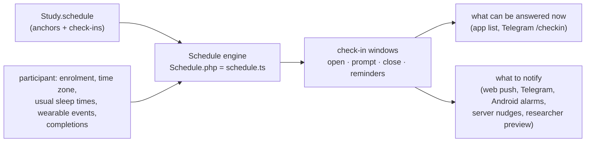

# Scheduling

Partial Implemented and unit-tested on every channel; not yet run in a live study.

A study has **one schedule** (`Study.schedule`, edited under **Edit study → Schedule**). It is the only place that
says when a questionnaire can be answered and when participants are prompted, for every channel:

The engine exists twice, as a line-by-line port: `src/backend/schedule/Schedule.php` on the server and
`web-pwa/src/lib/schedule.ts` in the participant app (web and Android, which always ship together). Both run
`test/fixtures/channels/schedule.json`, so they cannot drift apart. Channels only deliver what the engine says: none
of them has scheduling rules of its own.

Questionnaires carry no scheduling settings. A questionnaire without a check-in is never open and never prompted.
Older study configs (per-questionnaire schedules, sensor triggers, completion filters, active periods and the earlier
daily check-in plan) are upgraded into this schema once (see [Upgrading older configs](#upgrade)).

## The schedule {/* #schedule */}

Study-wide fields (all optional; omitted means the default):

| Field | Default | Meaning |
| --- | --- | --- |
| `checkins[]` | `[]` | The check-ins, see below. |
| `dayStart` | `0` | When a study day starts, ms after midnight (e.g. 04:00). "Until the end of the day" and "once per day" use study days. |
| `overlap` | `defer` | Check-ins are open one at a time: `defer` opens the next one no earlier than the previous window closes; `truncate` closes the previous window when the next opens. Check-ins marked `parallel` are left out. |
| `responseMinutes` | `60` | Response window after a prompt (`available: prompt`); 0 = until the range ends. |
| `cooldownMinutes` | `0` | A check-in opens, and is prompted, no earlier than this long after another check-in was completed (check-ins that are not `parallel`). |
| `segments` | `0` | Parts the waking day is split into for `split` boundaries; 0 = one per check-in. |
| wake-up and bedtime anchors | | See [Anchors](#anchors). |

### Check-ins {/* #checkins */}

Each check-in is one questionnaire with a daily window. A questionnaire can have several check-ins (e.g. two daytime
check-ins of the same questionnaire).

| Group | Field | Default | Meaning |
| --- | --- | --- | --- |
| | `questionnaireId` | | The questionnaire. |
| **Days** | `dayFrom` | `0` | First day, counted from the enrolment day (day 0). |
| | `dayUntil` | `-1` | Last day (inclusive); -1 = no end. |
| | `everyDays` | `1` | Every N days from `dayFrom`. |
| | `weekdays` | `0` | Bitmask, Sunday = bit 0; 0 = every day. |
| | `dayOfMonth` | `0` | Only on this day of the month; 0 = any. |
| | `dateFrom` / `dateUntil` | `0` | Absolute dates (ms): no window opens before / after; 0 = none. |
| **Range** | `startType` / `endType` | `split` | `fixed` clock time, `wake` / `usualWake` / `bed` plus an offset, or `split` point (see [Boundaries](#boundaries)). |
| | `startTime`, `startOffsetMin`, `startSegment`, `startNextDay` (and `end…`) | | The boundary's value. |
| **Prompt** | `prompt` | `start` | `start` of the range, `random` minute inside it, `wake` when the participant gets up, `event` when a wearable reports something, or `none`. At most once a day. |
| | `promptGraceMin` | `0` | `wake`: minutes after the usual wake-up before the fallback prompt. |
| | `event…`, `fallback…` | | `event`: see [Event prompts](#event-prompts). |
| **Open** | `available` | `prompt` | `prompt`: from the prompt for the response window; `range`: throughout the range, also before the prompt; `day`: from the prompt until the study day ends. |
| | `responseOverride`, `responseMinutes` | `false`, `60` | This check-in's own response window. |
| **Completion** | `limit` | `window` | `window`: once per window; `day`: once per study day; `once`: once in the whole study; `none`: as often as the participant likes while it is open. |
| | `minGapMinutes` | `0` | After completing this questionnaire, it opens again no earlier than this. |
| | `parallel` | `false` | Open alongside the other check-ins: it neither waits for nor shortens them and takes no part in the cool-down (e.g. a questionnaire open any time). |
| | `autoStart` | `false` | The participant app starts it by itself when the participant reaches the study while it is open (e.g. usual sleep times on day zero). |
| **Notification** | `title` | `''` | Notification title; empty = the questionnaire title (else the study title). |
| | `text` | `''` | Notification text; empty = "You have a questionnaire to complete." |
| | `reminderCount`, `reminderDelayMin` | `0`, `5` | Reminders after the prompt, while the window is open and the check-in not done. |
| | `includeDeadline` | `false` | Appends "Complete by HH:MM" (the window's close). |

Common patterns:

| Pattern | Check-in |
| --- | --- |
| Fixed EMA beep, open 30 min | `fixed` 10:00–10:00 range, `prompt: start`, `available: prompt`, response 30 |
| Stratified random EMA | `fixed` 10:00–12:00, `prompt: random` |
| Diary open all evening | `fixed` 19:00 – `fixed` 04:00, `available: range` |
| Morning when getting out of bed | `wake` + 0 – `wake` + 180, `prompt: wake`, `available: range` |
| Questionnaire open any time | `fixed` 00:00 – `fixed` 00:00 next day, `prompt: none`, `available: range`, `limit: none`, `parallel` |
| Once, at onboarding | as above with `limit: once`, `autoStart: true` |
| Weekly, from week 2 | `dayFrom: 7`, `everyDays: 7` |

### Boundaries {/* #boundaries */}

Each end of a range is

- `fixed`: a clock time; with `…NextDay` on the next calendar day (e.g. until 02:00 tomorrow);
- `wake`: the participant's wake-up plus an offset; with `…NextDay` the next day's wake-up;
- `usualWake`: the usual wake-up (the wake-up fallback, tiers 1–2, never the observed one) plus an offset, known before
  the participant gets up;
- `bed`: the participant's bedtime plus an offset;
- `split`: point k of the waking day (wake-up to the planned bedtime) divided into `segments` equal parts.

A clock-time end before the start is the next day's. A range that needs a wake-up not known yet has no window yet.

### Anchors {/* #anchors */}

Wake-up and going to bed have tiered fallbacks:

| Tier | Wake-up | Going to bed |
| --- | --- | --- |
| Observed | earliest wearable event in the window (`wakeSensor`, `wakeProvider`, `wakeEvent` e.g. Withings `bed_out`, `wakeWindowStart`–`wakeWindowEnd`), or the answer to the wake-up check-in (`wakeFromCheckin`) | first wearable event of the night in the window (`bedSensor`, `bedProvider`, `bedEvent` e.g. `bed_in`, `bedWindowStart`–`bedWindowEnd`), after waking up |
| 1, person-specific | latest answer to `wakeVariable` (e.g. `habitual_wake_time`) + `wakeOffsetMin`; on Saturdays and Sundays `wakeVariableWeekend` first | latest answer to `bedVariable` (e.g. `habitual_bedtime`) + `bedOffsetMin`; on Friday and Saturday nights `bedVariableWeekend` first |
| 2, fixed | `wakeDefault` (08:00) | `bedDefault` (23:00) |

An observation counts only when it comes before the fallback, which is therefore the latest the anchor can be. With
`wakeFromCheckin`, the first check-in starting at wake-up (`wake` + 0 or split point 0) can be answered from the start
of the wake-up window, before any prompt; answering it marks wake-up and re-plans the day, also offline in the app.
Split points always use the planned bedtime.

### Event prompts {/* #event-prompts */}

`prompt: event` prompts when a wearable reports an event (`eventProvider`, `eventKind`, e.g. Withings `bed_out` or
Fitbit `sleep`), the first of the day between `eventFrom` and `eventUntil` (-1 = the whole range), after a delay of
`eventDelayMin` (or a stable random delay up to `eventDelayMaxMin`). Without an event by the fallback time, it prompts
at the fallback: `fallback: fixed` at `fallbackTime`; `variable` at the participant's answer to `fallbackVariable` plus
`fallbackOffsetMin` (else `fallbackTime` if `fallbackDefault`); `none` never. Until then the window is not open (with
`available: range` it is, without a prompt). Events only reach the server; the app learns them when it is online.

## How windows are worked out {/* #windows */}

For each day (yesterday, today and the days ahead) and each check-in whose days include it:

1. The range from its two boundaries.
2. With `overlap: defer`, the earliest it can open is when the previous window closes (not for `parallel` check-ins).
3. The prompt (`start`, `random`, `wake`, `event` or `none`), inside the range.
4. When it is open, from `available`.
5. A window closes when the next one opens, also across midnight (not for `parallel` check-ins).
6. Completions: the cool-down and `minGapMinutes` move a window's opening later; `limit` marks a window **done**.

Each window has a key (`YYYY-MM-DD:<check-in index>`) and belongs to the study day it opens in. The app records a
completion against that key; a completion the server learns from an upload (without a key) counts for the earliest
window of its questionnaire it falls into that is not done yet.

From the windows:

- **Open now**: the first window that is open and not done. Every channel shows exactly these.
- **Prompts**: each window with a prompt that is not done, plus its reminders while it is open and nothing has been
  completed for that questionnaire since it opened. One notification per minute; several check-ins in the same
  minute share one ("You have 2 questionnaires to complete"). Never sent more than 2 h late or after the window
  closed, and never twice. A participant's first run sends nothing that was already due, except a prompt that follows
  a wearable event or wake-up.

## Channels {/* #channels */}

| Channel | Uses |
| --- | --- |
| Web push (`PushSender`, cron every minute) | due prompts; the service worker drops items whose window the participant has completed meanwhile |
| Telegram (`ChannelDispatcher`) | due prompts start a conversation; `/checkin` offers the open windows |
| Android app | plans prompts as local alarms (offline, on the minute); prompts that depend on a wearable come from the server (`api/native_pending.php`) |
| App list (web and Android) | open windows, computed on the device from `api/schedule.php` (events, usual sleep times), so it works offline |
| Researcher preview (Push panel) | prompts of the first days for a sample participant |
| Calendar (editor) | a sample participant's windows (plan), each participant's windows and compliance (monitoring) |

The server learns completions from uploads (`ParticipantVariableStore`, `@completions`), the device from its own.

## Calendar {/* #calendar */}

**Edit study → Calendar** shows the windows day by day, from the same engine (`backend/schedule/ScheduleCalendar.php`):

- **Plan**: a sample participant who joins on a chosen day, with sample answers to the questions the schedule reads
  (usual wake-up and bedtime, weekday and weekend, event fallbacks), for the schedule as it is being edited (unsaved
  changes are posted to `GetSchedulePlan`). Wake-up and events come at their fallback, as for a participant without a
  wearable; random prompts are drawn for the sample participant. Each window runs from when it opens to when it
  closes, with its prompt and reminders; the night between bedtime and wake-up is shaded.
- **Participants** (needs read permission, `GetScheduleMonitor`): every participant's compliance so far, and per
  participant their windows from enrolment (at most 120 days back) to a week ahead, in their own time. A window is
  **completed** (answered inside it), **done elsewhere** (a check-in answerable once per day or once in the study that
  was answered outside this window), **missed**, **open now** or **upcoming**; windows after a participant left the
  study are greyed out.

Compliance counts each closed window of a check-in answerable once per window, and each study day of a check-in
answerable once per day, against the ones completed; check-ins answerable any number of times or once in the study
are shown but not counted. Completions are read from the study's response files (every uploaded questionnaire, so the
whole history, also from before the schedule existed), wearable events from the participant's event store. The time
zone is the one saved with the participant's latest response (`timezone`, else `timezoneOffset`, sent by the web and
Android app since 3.7.1), else their Telegram binding, else their push subscription; without any the calendar shows UTC.

## Upgrading older configs {/* #upgrade */}

`ScheduleUpgrade` turns an older study into this schema. It runs once for every study when the server is updated to
3.7.0 (`admin/updateScripts/3.7.0.php`, after a backup of each study's config to `backups/schedule-upgrade/`), and on
every save of a config that is still in the old form (e.g. an imported file). Per questionnaire:

| Older setting | Becomes |
| --- | --- |
| Earlier daily check-in plan (`dailyPlan`) | the schedule's anchors and check-ins (those questionnaires' own schedules were already ignored) |
| Fixed signal time | a check-in prompted at that time, open until the end of the day (or "visible for" minutes) |
| Random signal time, N times in a window | N check-ins, one per equal part of the window, each prompted at random |
| Fixed completion window without signals (`completableAtSpecificTime`) | a check-in open in that window, prompted when it opens |
| Wearable sensor trigger | an `event` check-in with the same event, window, delay and fallback |
| No schedule at all | a check-in open any time |
| Active period (`durationStartingAfterDays`, `durationPeriodDays`, `durationStart`, `durationEnd`) | each check-in's days |
| `completableOnce` / `completableOncePerDay` / otherwise | `limit: once` / `day` / `window` (`none` for questionnaires without a schedule) |
| `limitCompletionFrequency` | `minGapMinutes` |
| Notification text, title, reminders, `notificationIncludeDeadline` | the check-in's notification |
| `dayStartTimeOfDay` | `dayStart` |
| `askAtOnboarding` | `autoStart` |

Check-ins converted from per-questionnaire settings are `parallel`, as those were independent of each other; the earlier
daily plan's check-ins stay one at a time. The old fields are removed. A sensor trigger with more than one prompt a day keeps one; a fixed completion window
combined with signal times keeps the window and prompts when it opens. Other ESMira event cues were never run by this
server and are left as they were.
