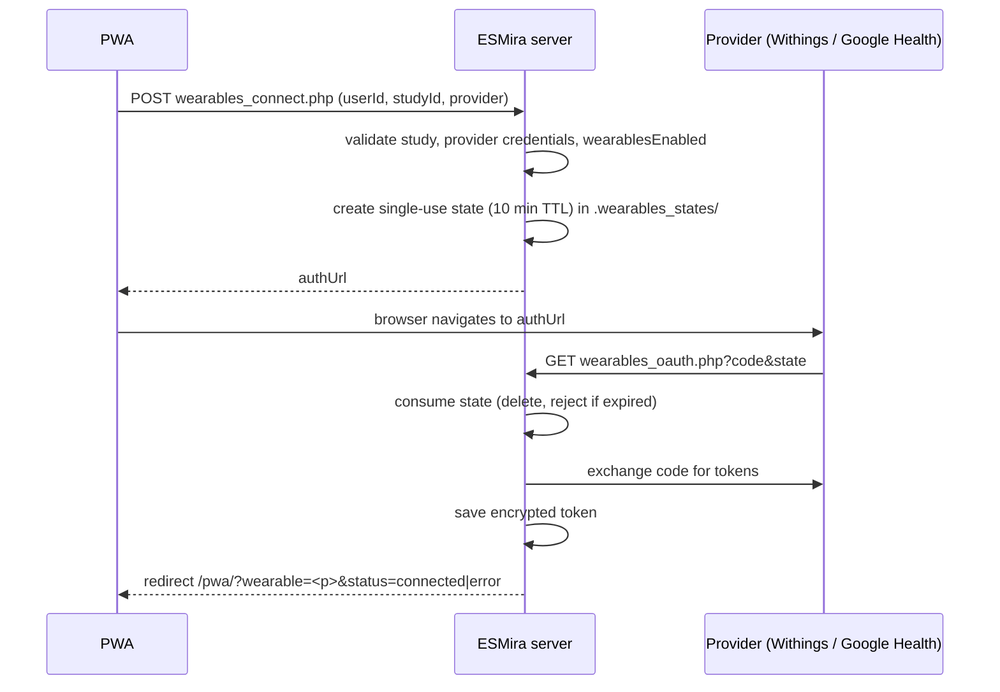
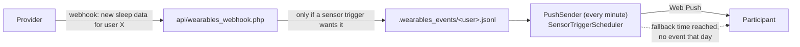

# Wearables

<span className="status status--shipped">Shipped</span> ingestion and export · fork-only
<span className="status status--partial">Partial</span> webhook-triggered prompts for Withings and Google Health (untested against live providers)
<span className="status status--tbc">TBC</span> tailoring prompts from measurement values

Participants can link a consumer wearable to a study. The server pulls their data on a schedule and stores it
for the researcher, and can use provider webhooks to trigger prompts.

:::caution[What this feature does *not* do]
Measurement data is **stored and exported only**. The hourly sync fetches *completed days only*, so it is
typically a day old, and no code reads the values to decide anything. Prompts can be triggered by a webhook
saying *new data of a type arrived*, see [Webhooks and sensor triggers](#webhooks-and-sensor-triggers). There
is no value threshold and no real wake-up detection. See [Current status](../current-status.md).
:::

## Providers and data

| Provider | Data types fetched by default |
| --- | --- |
| **Google Health** (Fitbit / Pixel Watch) | steps, heart rate, sleep, weight, SpO₂, HRV, respiratory rate (sleep summary). One row per UTC day, value = that day's data points verbatim |
| **Withings** | weight, blood pressure, activity, sleep (summary), ECG |

`Study.wearablesDataTypes` can narrow the list, but **no designer UI sets it**; use the study source. If it is
empty, or does not intersect the provider's list, the provider defaults apply.

## Server configuration

Credentials are server-wide, set with the CLI:

```bash
php cli/wearables_setup.php genkey                                  # token-encryption key
php cli/wearables_setup.php <withings|googlehealth> <client_id> <client_secret> [redirect_uri]
```

| Config key | Purpose |
| --- | --- |
| `wearables_<provider>_client_id` / `_client_secret` | OAuth application credentials. |
| `wearables_token_key` | 32-byte base64 key for token encryption. |
| `wearables_redirect_uri` | Optional; default `scheme://host/<api dir>/wearables_oauth.php`. |
| `wearables_pwa_path` | Optional; where to send the browser back (default `/pwa`). |

There is **no environment-variable support** for these keys. The researcher panel shows the exact redirect
URI to register with each provider.

## OAuth 2.0 flow



- The `state` is `bin2hex(random_bytes(24))`, stored server-side with study, user and provider, and is
  single-use. It is **not bound to a browser cookie** and **PKCE is not used**.
- Scopes are requested together, not per data type: Withings `user.info,user.metrics,user.activity,user.sleepevents`;
  Google Health `sleep.readonly`, `activity_and_fitness.readonly`, `health_metrics_and_measurements.readonly`.
- Both authorization URLs send `prompt=login`.

## Token storage

One file per study, participant and provider:
`studies/<id>/.wearables_tokens/<userId>.<provider>`.

- Payload: JSON encrypted with libsodium `secretbox`, stored as `v1:` + base64(nonce + ciphertext).
- **Fallback:** if the `sodium` extension or key is missing, tokens are stored as `p0:` + **plaintext JSON**.
  The Docker image installs `sodium`, and `genkey` creates the key.
- Tokens refresh when under 5 minutes remain; the new refresh token is written immediately because Withings
  refresh tokens are single-use.
- The **client secret** and the token key are stored in plaintext in the server config file.

## Sync

The image runs `cli/wearables_sync.php` **hourly** (`0 * * * *`).

| Behaviour | Value |
| --- | --- |
| What is fetched | Whole completed **UTC days up to yesterday** |
| First run | Backfills 1 day |
| Catch-up cap | 14 days |
| Skipped when | `wearablesEnabled` is false, or provider not in a non-empty `wearablesProviders` |

## Stored data

`studies/<id>/.wearables_data/<userId>.<provider>.csv` with a `.state` cursor beside it. Append-only,
all fields quoted, server delimiter (default `;`):

```text
userId ; provider ; measurement_time ; data_type ; value ; fetched_at
```

`value` is the **raw provider JSON, verbatim**. Wearable CSVs are not encrypted on disk.

## Webhooks and sensor triggers {/* #webhooks-and-sensor-triggers */}

<span className="status status--partial">Partial</span> Not yet verified against live provider accounts beyond a single Withings test participant.



| Provider | Registration | Authentication of the callback | Types |
| --- | --- | --- | --- |
| **Withings** (Notify) | Automatic when the participant links: the server subscribes each type via `notify` with a URL carrying a key derived from the client secret. | Key in the URL (`k=`); Withings does not sign requests. | every data category: weight (1), temperature (2), blood pressure (4), activity (16), sleep (44), bed in/out (50/51), sleep sensor ready (52), ECG (54, 55), glucose (58), stethoscope (61), HRV (62), urine (63), bed status (98–100) |

Optional config key `wearables_webhook_uri` overrides the auto-derived public callback URL (needed behind a
proxy that rewrites the host or path). Participants who linked **before** this feature was deployed have no
webhook subscription until they re-link.

**Only these providers have webhooks.** The designer offers *Any connected wearable*, *Withings* and *Google Health*. The data types below are
the complete set the designer offers, each checked against the provider's own documentation (2026-10-09):

| Designer type | Withings `appli` | Google Health data types |
| --- | --- | --- |
| Sleep | 44 (sleep summary) | `sleep` |
| Activity | 16 (steps, distance, workouts) | `steps`, `distance`, `floors`, `active-minutes`, `active-zone-minutes`, `exercise` |
| Weight / body | 1 (weight and body composition) | `weight`, `body-fat` |
| Out of bed | 51 (Sleep Analyzer / sleep mat bed-out event) | not available |
| Other Withings-only events | 2, 50, 52, 55, 58, 61, 62, 63, 98–100 (see the designer list) | not available |
| Blood pressure | 4 (blood pressure and heart rate) | not available |
| ECG | 54 (ECG measurement) | not available (ECG data exists, but has no webhook) |

Sources: [Google Health webhooks](https://developers.google.com/health/webhooks) and [Withings notification content](https://oauth.withings.com/developer-guide/v3/data-api/notifications/notification-content/).
Withings account events (46 profile changed, 53 device set up, 60 survey answered) carry no data and are not offered. Most Withings categories need a specific device and a participant without it never receives that event.
*Out of bed* (51) is a closer wake-up signal than "sleep summary synced", but only for owners of a Withings Sleep Analyzer.
It fires on every bed exit, including night-time ones, so pair it with the daily window and the per-day cap. The 10-minute
bed status events (98–100) need Live Sync enabled on the device. Participants who linked **before** an event was added
have no subscription for it until they re-link.

:::note[Fitbit is no longer a provider]
Fitbit's legacy Web API is turned off on 2026-10-30, so ESMira dropped its Fitbit provider (OAuth linking, hourly sync
and webhooks). Fitbit and Pixel Watch data reach ESMira through **Google Health**. A study imported from an older
version may still name `fitbit` as its trigger provider or in `wearablesProviders`; the designer flags such a
trigger as never firing, and the leftover entries are otherwise ignored. Token files and data written earlier stay on
disk but are no longer read or synced.
:::

### Google Health API

<span className="status status--partial">Partial</span> Implemented, untested against a live project.

:::caution[Not yet verified against a live project]
Written from Google's documentation. Google caps an unverified OAuth app at 100 users (more needs a third-party
security review), and while the consent screen is in *Testing* each user must be a listed test user and refresh
tokens expire after 7 days: publish the app before a study. Measurement download (below) and the webhook path
have not been run against a real Google account.
:::

Triggers and measurement download. Data points are read from `users/me/dataTypes/<id>/dataPoints` with a per-day UTC filter
(`steps`, `heart-rate`, `heart-rate-variability`, `oxygen-saturation`, `respiratory-rate-sleep-summary`, `sleep`, `weight`);
a type whose scope was not granted (HTTP 403) is skipped.

- **Sign-in:** Google OAuth 2.0; credentials in the body; `access_type=offline` + `prompt=consent` for a refresh token; 1 h access tokens
- **User id:** Not in it; `GET /v4/users/me/identity` right after sign-in (`healthUserId`). `ACCOUNT_NOT_LINKED` (no Google Health profile) aborts the link.
- **Webhook registration:** **Once per server**, as a "subscriber" with `AUTOMATIC` subscriptions; nothing happens at link time
- **Callback check:** Two POSTs `{"type":"verification"}`: with the secret expect 2xx, without it 401/403
- **Authenticity:** Secret in `Authorization` **and** an ECDSA P-256 signature (`GOOGLE-HEALTH-API-SIGNATURE`, Tink prefix) against Google's published keyset
- **Delivery:** Batches of up to 99; must answer 204 at once; retried for 7 days, so events can repeat (harmless: the cap and ledger absorb them)

Setup:

```bash
php cli/wearables_setup.php googlehealth <client_id> <client_secret>   # OAuth client from your Google Cloud project
php cli/wearables_setup.php googlehealth-webhook                        # creates the webhook secret, prints the subscriber request
```

Send the printed request to `https://health.googleapis.com/v4beta/projects/<PROJECT NUMBER>/subscribers?subscriberId=esmira`
(project *number*, not id; needs the `health.subscribers.create` permission). The OAuth redirect URI is the same
`wearables_oauth.php` shown in the researcher panel.

What is and is not done:

- Requested scopes: `sleep.readonly`, `activity_and_fitness.readonly`, `health_metrics_and_measurements.readonly`
  (the three Google's webhook page ties to sleep, activity and weight; its scope page gives no per-type mapping).
- **Measurement data is not downloaded**, so a Google Health participant adds no rows to `wearables.zip`; the
  hourly sync skips the provider.
- Unverified: whether Google's scopes count as sensitive/restricted (affecting app verification, and whether a
  project in *Testing* mode, whose refresh tokens expire, is enough), and the exact notification envelope. The
  parser accepts the plausible shapes. If genuine notifications are rejected with 403, set the server config key
  `wearables_googlehealth_skip_signature` to bypass the signature check (the secret stays required).
- The webhook route must receive the `Authorization` header. Under Apache with PHP-FPM/CGI that needs
  `SetEnvIf Authorization "(.*)" HTTP_AUTHORIZATION=$1` or an equivalent rewrite.

- The endpoint answers 200/204 quickly (Google Health requires a 204 at once). A bad Withings key gets 403; a missing Google Health secret gets 401.
- The callback maps the provider's user id to participants by scanning the token files, then stores an event
  **only** for studies that have wearables enabled and a sensor trigger for that provider and type. The event
  is the time the webhook arrived, kept for three days; it contains no measurement.
- Subscription is best effort: if it fails, linking still succeeds and the trigger's time fallback is what
  fires. An incomplete subscription is written to the server error log.
- Disconnecting the last linked device deletes the participant's event log.
- The Withings callback URL carries one key shared by all participants and appears in web server access logs;
  anyone who learns it can forge events for a Withings user id. Keep query strings out of access logs, and note
  that rotating the Withings client secret invalidates existing subscriptions (participants must re-link).
- Ceilings: the provider decides when to call the webhook (devices must sync first), so latency is not under
  ESMira's control.

Designer settings and exact semantics: [Scheduling](./scheduling.md#sensor-triggers).

## Researcher panel

Source: `sections/wearables.tsx`.

- Enable toggle (`wearablesEnabled`).
- Provider checkboxes, disabled when the server has no credentials, each with a connected-participant count.
- A **participant table** (`WearablesParticipantOverview`): every participant who has sent data or linked a device, with the
  providers they connected, the last sync date per provider and whether data arrived. Participants who have not
  connected are listed first, with a "N of M participants have connected a wearable" summary. It is built from file
  names and sync-state files, so no token is decrypted. "Last sync" is the last completed UTC day fetched, not the
  device's own upload time. A link the provider has rejected is shown as "link no longer valid, participant must
  reconnect" and no longer counts as connected (see *Revoked links* below).
- A **last sensor event** column in that table: the newest webhook event still in the participant's event log (kind,
  provider, time). It proves the provider reaches this server for that participant. Events are only logged for kinds
  a trigger of the study waits for and are kept for 3 days, so "none in the last 3 days" can also mean no trigger
  wants that kind.
- A provider whose credentials are set but whose notifications this server cannot receive yet (for Google Health:
  no webhook secret from `wearables_setup.php googlehealth-webhook`) is flagged "sensor triggers unavailable".
  Whether Google has the subscriber registered in the Cloud project cannot be seen from here.
- A read-only box with the **redirect URI** to register.
- A **`wearables.zip`** download (read permission); the same link appears in the data list.

There is no data preview or data-type selector. Sensor triggers are
configured per questionnaire in the trigger editor, not here.

## Revoked links

A link stops working when the participant revokes access at the provider, or when the same provider account is linked
from a second participant ID (Withings, for one, allows a single active authorization per account and app, so linking
again silently invalidates the first participant's access and refresh tokens). The sync recognises a rejected token
or refresh token (`WearablesAuthException::matches`), writes a `<participant>.<provider>.revoked` marker next to the
sync state, and stops retrying that link instead of logging an error every hour. The marker is returned as
`needsReconnect` by `wearables_status.php` and the researcher panel; the participant app then offers **Reconnect**.
Saving a new token (any successful link) removes the marker, and the sync cursor was left in place, so the missed days
are fetched afterwards (up to the 14-day catch-up cap). Transient failures such as timeouts or provider outages never
set the marker.

## Participant flow and disconnect

The PWA shows a *Wearables* tile only when the study has wearables enabled **and** at least one of its
providers is configured on the server. *Connect* navigates to the provider; *Disconnect* calls
`wearables_disconnect.php`, which deletes the local token, data CSV and cursor for that provider.

## Known limitations

- **No provider-side revocation:** disconnect does not revoke the token at the provider.
- **Weak endpoint authentication:** `wearables_status.php` and `wearables_disconnect.php` check only
  `studyId` + `userId`.
- **Empty provider list mismatch:** the server treats an empty `wearablesProviders` as "all allowed"; the PWA
  treats it as "none offered".
- **Reset study does not clear wearable or push folders** (`emptyStudy`).
- **Delete behaviour of wearable folders on study deletion** was not verified.
