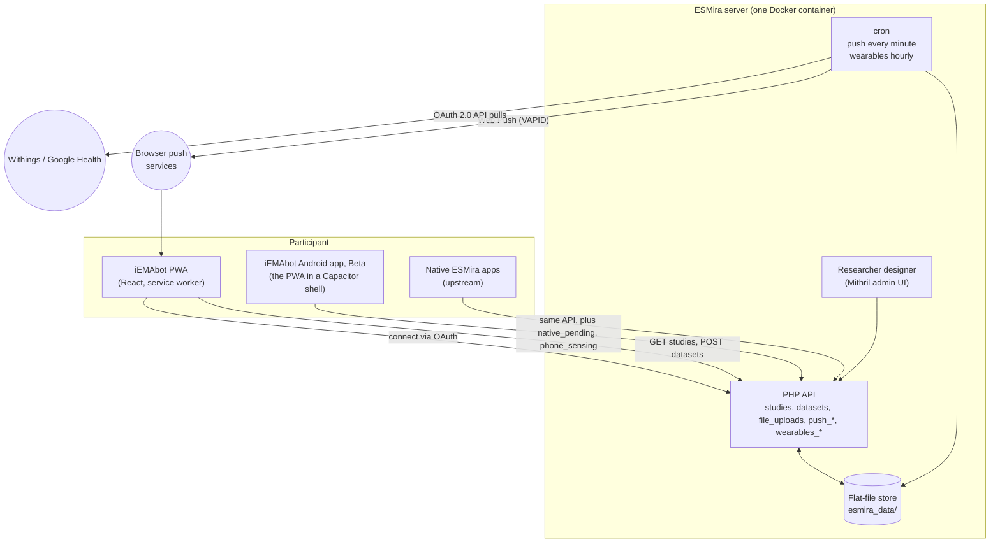

import {ForkStat} from '@site/src/components/ForkStats';
import {Maintainers} from '@site/src/components/Maintainers';

# iEMAbot

**iEMAbot** is an open-source Ecological Momentary Assessment (EMA) framework for circadian and sleep
research. It is built on [ESMira](https://github.com/KL-Psychological-Methodology/ESMira), a
self-hosted EMA platform developed by KL Psychological Methodology, and extends it with:

- an installable, chat-style **participant PWA** (`web-pwa/`) that works in any modern browser,
- **Web Push** reminders driven by ESMira's own schedule model,
- an **Android app** (Beta) with reminders that fire offline and optional phone sensing, sharing the PWA's code,
- **wearable linking** (Withings, Google Health) over OAuth 2.0, with researcher-side export,
- participant-side **voice memos**, a **keystroke-dynamics typing fallback**, embedded **cognitive tasks**, and
- an automated **WCAG 2.2 accessibility audit** gating every deploy.

This site documents the basic features of the ESMira backend and the PWA, and concentrates on the parts
where **this fork diverges from the upstream repository**.

## How to read this documentation

Every feature carries one of three status badges. They describe what is in the code **today**, not what is
planned.

| Badge | Meaning |
| --- | --- |
| Shipped | Implemented in this repository and used in the reference deployment. |
| Partial | Some of the behaviour exists; the page states precisely which part. |
| TBC | Not implemented (or not verified). The page holds a placeholder so the gap is explicit rather than hidden. |

## Where to start

| If you are… | Read |
| --- | --- |
| A researcher who wants to use iEMAbot and needs a server | [Getting started: for researchers](./getting-started/for-researchers.md), with an email for your IT department |
| IT staff asked to host it for a research team | [Getting started: for IT](./getting-started/for-it.md) |
| Checking the project's current status | [Current status](./current-status.md) |
| Familiar with upstream ESMira and want the delta | [Fork divergence](./fork-divergence.md) |
| A researcher designing a study | [Question types](./backend/question-types/index.md), [Study model](./backend/study-model.md), [Scheduling](./backend/scheduling.md) |
| Choosing how participants are reached | [Channels](./backend/channels/index.md), [Web Push](./backend/channels/web-push.md), [Wearables](./backend/wearables.md) |
| Running a server | [Docker and cron](./deployment/docker-and-cron.md), [CI and release](./deployment/ci-and-release.md) |
| Looking at the participant experience | [PWA overview](./pwa/overview.md), [Participant flow](./pwa/participant-flow.md) |
| Interested in the Android app (Beta) | [Android app](./backend/channels/android-app.md), [Phone sensing](./backend/channels/phone-sensing.md) |

## Architecture at a glance

For the product-level picture (study editor, server, channels, data export, and the optional voice route), see
[Platform architecture](./architecture.md). The technical view:

There is **no database server**: studies, responses, media and tokens live as files under `esmira_data/`,
and everything collected from participants is also written to one embedded SQLite database there
(see [SQLite store](./backend/sqlite-store.md) and [Data and privacy](./backend/data-and-privacy.md)).

## Naming

- **ESMira**: the engine (server, designer, data model). Kept as the engine name throughout.
- **iEMAbot**: the participant-facing brand of this fork (PWA name, invite pages, logo).
- **Upstream**: [`KL-Psychological-Methodology/ESMira-web`](https://github.com/KL-Psychological-Methodology/ESMira-web).
- **Fork**: [`andreifoldes/iEMAbot`](https://github.com/andreifoldes/iEMAbot), the repository this site is built from.

## Maintainers {/* #maintainers */}

<Maintainers />

For questions about the project, [Discussions](https://github.com/andreifoldes/iEMAbot/discussions) is the best place to start.

:::note[Point-in-time facts]
The version numbers and diff sizes on the [Fork divergence](./fork-divergence.md#numbers) page are computed
when the site is built (now as of <ForkStat name="asOf" />; root `package.json` version
<code><ForkStat name="forkVersion" /></code>). Other counts and dates on these pages are point-in-time and may lag.
:::
