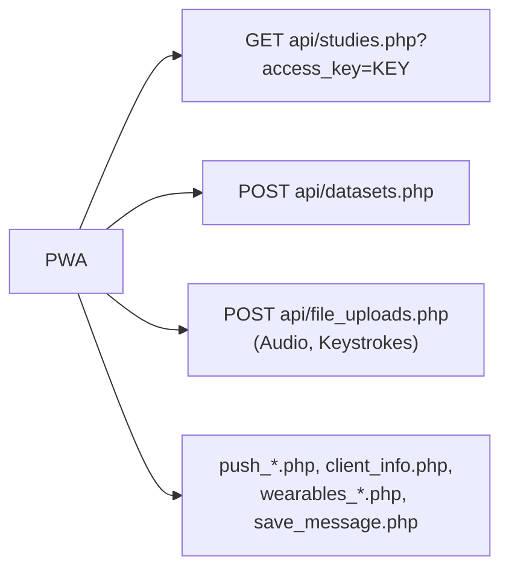

# PWA overview

Shipped · fork-only

The participant app lives in `web-pwa/`. It is a **React 19 + Vite + Tailwind 4** single-page app with a
service worker, presented as a WhatsApp-style thread: one question card at a time, a progress bar, and
rich-text bubbles. It is branded **iEMAbot** in the UI.

## How it talks to ESMira

- **Read:** the study JSON, plus `serverVersion`, `vapidPublicKey` and `wearableProviders`.
- **Write:** responses go to `datasets.php` in the exact shape the native apps use, so the server writes the
  same CSVs. A `joined` event is sent at consent; each completion sends a `questionnaire` event with
  `formDuration` and the user agent as model.
- **Adapter:** `esmiraAdapter.ts` maps ESMira study JSON to the internal survey engine; `surveyEngine.ts`
  runs it. Pages become chat sections (the page header is the divider); `randomized` pages are shuffled per
  session.
- **User ID:** URL parameter (`pid`, `uid`, `user_id` or `userId`) → stored value → random UUID.

## Build and serving

| Item | Value |
| --- | --- |
| Source | `web-pwa/src/` (`App.tsx` holds the flow and modals; `components/`, `lib/`) |
| Build output | `<repo>/dist/pwa/` |
| Vite base | `/pwa/` |
| Build order | Root `npm run build:all` runs the ESMira webpack build **first** (it cleans `dist/`), then the PWA |
| Dev server | `cd web-pwa && npm run dev` (port 5174, proxies `/esmira/api` to `ESMIRA_PROXY`) |
| Tests | `cd web-pwa && npm test` (Node's built-in runner, no dependencies) |
| Type check | `npm run lint` (`tsc --noEmit` for app and worker) |

The Docker image copies `dist/` into the web root, so `/pwa/` is served as static files next to ESMira.

## Interface language {/* #interface-language */}

The app's buttons and messages come from its own translation files (`src/locales/pwa/<code>.json`, see
[Help develop](../help-development.md#translations)), packed into one small chunk per language at build time so
they work offline and inside the [Android app](../backend/channels/android-app.md). Participants do not choose
the language. The researcher does, per study, with **Participant app language (web)** in the study settings
(`webLanguage`). With *Automatic*, the app uses the study's language, then the browser's languages, then English.
A language that has no translation for a string shows that string in English.

**Machine-translated languages.** Some languages have been translated by a machine (Crowdin's engine) and not yet
reviewed by people. They are labelled **(machine-translated)** in the study settings, and the app says so on its
About screen. Because nobody has checked them, the app never picks one just because of the participant's phone
settings: it is used only when the researcher chooses it, or the study itself is written in that language. Once
people have reviewed a language, it is taken off the list (`src/locales/meta/pwa-machine-translated.json`) and then
behaves like any other. Today that list is Danish, Finnish, Norwegian and Swedish.

The same setting picks the language of the study's own text (questions, descriptions) when the study has been
translated into it: the app asks the server for that language with `studies.php?study_lang=…`, which, unlike the
dashboard's `lang` parameter, does not set the language cookie. A study that has no translation in that language
is shown in its default one. Read-aloud speaks a question in the study's language, not the interface language.

## Manifest and installability

`display: standalone`, portrait, `scope`/`start_url` `/pwa/`, theme colour `#075E54`, 192/512/maskable icons.
The manifest's `start_url` carries no key; in standalone mode the last working invite code is restored from
`localStorage` (`esmira_last_key`). `public/.htaccess` disables caching for `sw.js` and the manifest.

## Service worker

Built with `vite-plugin-pwa` (`injectManifest`, auto-update).

| Concern | Behaviour |
| --- | --- |
| Precache | App shell: js, css, html, svg, png, jpg, ico, woff2. |
| Navigation | SPA fallback to `index.html`, excluding `/esmira/api/`. |
| Study data | `NetworkFirst` for `studies.php`: 5 s timeout, 16 entries, 30 days, keyed per access key. This is how a previously opened study works offline. |
| Fonts | `CacheFirst` for Google Fonts (Inter), one year. |
| Updates | `skipWaiting` + `clientsClaim`; the page reloads on `controllerchange` **only if a controller already existed**, so the first install does not reload. |
| Push | Shows one notification, filters stale/done/duplicate items, posts `received` / `clicked` receipts. See [Web Push](../backend/channels/web-push.md#suppressing-reminders). |
| Legacy cleanup | On startup, unregisters a legacy root-scope (`/`) service worker and deletes `m2c2*` caches. |

## Runtime stack

React 19, Vite 8, Tailwind 4, `motion`, `lucide-react`, TypeScript. `App.tsx` is large (~2,600 lines) because
the whole participant flow and its modals live there.

## Not part of the repo

The cognitive-task wrapper pages are hosted separately; see [Cognitive tasks](../backend/question-types/cognitive-tasks.md).
`public/invite-generator.html` is a standalone tool for building bulk invite links
(`?key=…&id=…&pid=…`). By default it makes **random** participant IDs (12 characters, 60 bits, from the browser's
crypto generator), which cannot be guessed. Sequential (`P001`, `P002`, …) and hand-typed IDs are still possible but the
page warns about them: a participant ID is what identifies a participant to the server, so anyone who knows or guesses one
can act as that participant in the app. A participant who opens the app without a `pid` gets a random ID (a UUID) on their device.
