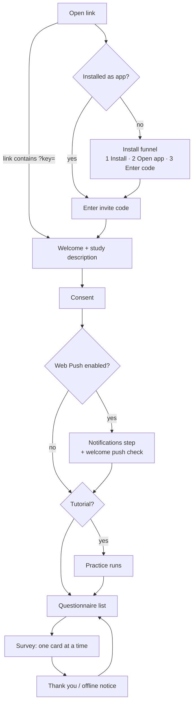

# Participant flow

Shipped

## Invite and install

An invite is a URL with `?key=` (or `access_key`). Without one, the app asks for a code.

**Install-first funnel.** In a plain browser tab the code box is **hidden** and a three-step panel is shown:
*Install the app → Open the installed app → Enter your invite code*. The input appears only in standalone
display mode. A `?key=` URL bypasses the gate. The point is to get participants onto the installed app,
where push works reliably.

`InstallPrompt.tsx` adapts to the browser, using the detection in `lib/pwaInstall.ts`:

| Situation | Guidance |
| --- | --- |
| Install prompt captured (Chromium) | A real **Install app** button. |
| Inside an in-app browser (WhatsApp, Instagram, Facebook, Mail…) | "Open this page in your browser": **Copy link**, then open it in Safari (iOS) or *Open in Chrome* (Android). Web-views can't install a PWA. |
| iOS / iPadOS Safari (16.4+) | Share → **Add to Home Screen**, worded for Safari. |
| iOS / iPadOS Chrome (v113+, iOS 16.4+) | The same, worded for Chrome (Share beside the address bar → *View More*). |
| iOS older than 16.4, Chrome older than v113, or another iOS browser | An amber alert instead of steps: update iOS / Chrome, or open the page in Safari or Chrome. The check **fails open** when a version can't be read (e.g. iPadOS posing as a Mac). |
| macOS Safari | File → **Add to Dock**. |
| Android without a captured prompt | Browser menu → *Install app* / *Add to Home screen*. |
| Desktop Chromium | Address-bar install icon or menu. |
| Unsupported (e.g. desktop Firefox) | "Open in Chrome, Edge or Safari", a **Copy link** button, and the QR code below. |

Around that:

- **Phone handoff.** On a desktop or laptop, *Use your phone instead* reveals a QR code (plus **Copy link**) so
  the participant can carry on from their phone; it is open by default where the desktop browser can't install.
  The QR code is a separate lazy-loaded chunk.
- **After installing.** Once the browser reports the install finished, the install card is replaced by
  *"Added to your Home Screen! Now open iEMAbot from there"*, step 1 of the funnel is ticked and step 2
  becomes the active one. Installing does not turn the current tab into the app, so the participant must open
  the installed icon. A *"Can't see the app after adding it?"* hint explains where iOS and Android put the icon.
- **Invite code and participant ID on iOS.** The iOS home-screen app starts with empty storage, so a code that
  arrived as a `?key=` link, and the participant ID of a personalised `?key=&pid=` link, don't carry over. When the
  notifications step sends an iOS participant to install first, both are shown ("Write these down"). The installed
  app's code-entry screen takes the invite code and an optional **Participant ID**, and sends the participant to
  `?key=…&pid=…`, so enrolling by typing behaves exactly like opening the link. (Android and desktop-Chromium installs
  share storage with the browser, which restores the last working code and ID.)
- **Early prompt capture.** Chromium fires `beforeinstallprompt` once, early. `main.tsx` calls
  `initInstallCapture()` before React mounts and the prompt is held at module level, so screens that mount later
  still get the **Install app** button. The same module owns the single `standalone` check that the funnel,
  the study load and `InstallPrompt` share.

### Smartphone-only studies

A researcher can tick **Only allow participation on a smartphone (web)** in the study settings (the
`webPhoneOnly` field; it needs **Web** ticked under study availability). On any other device the app does not
start the study. It shows an **invite page** instead, laid out top to bottom as:

1. what to do: this is a smartphone study, open the link on your phone;
2. the **invite code and participant ID to write down** (see *Invite code and participant ID on iOS* above);
3. the **QR code**, centred, for the same link (invite code and any participant ID included). Tap it to enlarge
   it in a lightbox; Esc, the X or a tap outside closes it;
4. **Other ways to open it**: *Copy the link to send it to yourself* and, on touch devices, *I'm on my phone,
   continue here*;
5. the tip *open it in Safari or Chrome (iPhone), or Chrome (Android)*.

The hosted study page (`/<access key>` on the ESMira server) shows the same layout on desktop, with *On your
phone? Tap to open directly* among the other ways, and says "smartphone" instead of "smartphone or tablet" for
these studies.

- **Nothing is recorded first.** The check runs as soon as the study loads, before the user id, the participant-ID
  lock, consent and the join event. Scanning the code on a phone therefore starts from a clean slate and never hits
  "already active on another device". The invite page also hides the menu, whose actions (contact, error report,
  notifications, wearables) all need a participant id.
- **What counts as a phone.** A touch device whose shorter physical screen edge is under 600 px (`isPhone()` in
  `lib/pwaInstall.ts`). It reads `screen.*`, so orientation and the iOS "Request Desktop Website" mode don't matter.
  Tablets, 7-inch tablets (Android treats 600 px as a tablet) and the inner screen of an unfolded foldable count as
  larger devices.
- **Escape hatch.** Touch devices that are not phones (tablets, foldables, a large phone we misread) also see
  *I'm on my phone, continue here*. It is remembered for that study on that device. Computers never see it.
- **Nobody is locked out mid-study.** A device that already consented to the study is never gated, so switching
  the setting on later doesn't turn existing participants away.
- **Off by default.** Only an explicit `true` gates, so existing studies behave as before.
- **A convenience, not a lock.** The check runs in the participant's browser, so it protects data quality, not access.

## Consent and join time

The study description (HTML) and consent text are shown, then *I consent* / *I do not consent*. A generic
*Welcome to &lt;title&gt;.* line comes first, unless the description itself opens with "Welcome". The app
never asks for a name: the participant is identified only by the participant ID, which is assigned
automatically (or taken from the invite link). A display name stored by an older version is forgotten on the
next launch. **The consent time is the enrolment anchor** (`esmira_joined_*`, event `joined`), from which
`durationStartingAfterDays` and similar fields count.

Whenever the app says several things in a row (welcome, description and consent; the tutorial intro and its
instructions; the closing bubbles after a check-in), the bubbles appear one after another instead of all at once.
This is always on, for every study. Before each bot bubble that follows another bot bubble, a typing indicator
stays up for the previous bubble's reading time (`lib/pacing.ts`), at least 1.2 s and at most 10 s, minus however long that bubble has already been on screen. The first reply to something the
participant did, their own bubbles and settled question/answer pairs are never held back. Buttons, the
questionnaire list, question cards and the text field wait for the last bubble, so nothing to tap appears above
text still to come. A returning participant who reopens the app sees the opening bubbles at once. The Telegram
bot paces its messages by the same rule, with Telegram's own "typing…" indicator
(`src/backend/channels/ReadingPace.php`). The reading speed is a study setting, **Message pacing (words per minute)** (`messagePacingWpm`): 238 by
default (an average adult reading speed), lower for more time, 0 to show messages at once. The former study field
`webPacedMessages` is no longer read.

## End-of-questionnaire snapshot

A study with `webSnapshot` set to `checkin-readout` (source-edit only) adds three messages after a check-in, mirroring
the Telegram bot's check-in study:

1. **Snapshot**: a mood line from the I-PANAS-SF items (`alert`, `inspired`, `active` against `nervous`, `upset`,
   `afraid`) and a sleepiness line from the `kss` item.
2. **Your answers**: the participant's own answers in question order, with short labels for a few items, `/5` on
   scales and, for the reaction-time game, a line such as *17 taps, average 555 ms, 7 lapses* (false starts are
   not taps). Like the bot, only questions that have an answer appear, so one hidden by its `show_if`
   (`relevance`) or skipped is left out; a skipped task is listed as *skipped*.
3. **Thank-you**.

It is computed in the browser by `lib/snapshot.ts`.

The thank-you ends the session: the app does not offer another questionnaire or show the list. When exactly one
questionnaire is open, such a study also skips the list on the way in: after consent (or on reopening the app) it
says *Let's go!* and starts the check-in, as the bot does after `/start`.

## Local-only studies

A study with `webLocalOnly` (source-edit only) sends nothing to the server. One switch in `lib/esmiraApi.ts`
(`setLocalOnly`, set as soon as the study loads) turns every writing call into a no-op: questionnaire and joined
datasets, other events, client telemetry, push subscription and test, wearables and the participant-ID lock. The
study itself is still fetched, and the *contact the research team* message is still sent if the participant
writes one. After a check-in the app says nothing was sent instead of "your responses have been recorded". The
ESRS 2026 mini check-in uses it, and its end screen says so. Server access logs of the study request remain.

## Task actions

With `webTaskActions` (source-edit only), a cognitive task card shows four buttons in two rows, as under a task in
the Telegram bot: **Start task**, **Skip task** (drops only the task), **Remind me later** and **Skip check-in**
(drops the whole questionnaire; nothing is submitted).

**Remind me later** parks the check-in on this device (see below) and returns to the list, which shows
*Paused — tap to carry on*. No push is scheduled, so the app says the answers are saved and does not promise a
reminder.

## Closing the app mid-check-in

The web and Android app save a check-in in progress **on this device** after every answer, skip and changed
answer, and when it starts (`lib/pausedCheckin.ts`, key `esmira_paused_<study>_<id>_<questionnaire>`): answers so
far, the position, the order of randomized pages and the drawn task battery, revealed skip fallbacks, any recording
or typing identifiers, and the window it was opened in. Nothing is sent to the server until the check-in is
submitted.

- **Background, then back**: nothing changes, the check-in is still on screen. If its window closed meanwhile, it
  still counts against the window it was opened in.
- **Closed or killed, reopened while the window is open**: the app reopens the check-in by itself, replays the
  earlier answers into the chat and carries on at the question it stopped on. One parked with **Remind me later**
  waits on the list instead.
- **Reopened after the window closed**, or once the questionnaire is done: the saved answers are dropped. A check-in
  is never resumed into a later window, so tomorrow's morning check-in starts empty.

Submitting or skipping the check-in clears the saved copy; one is kept per questionnaire. In the web app, an app
update that arrives during a check-in waits until it is over and applies the next time the app goes to the
background (`lib/reloadGate.ts`), so it does not reload the page mid-answer.

## Notifications step

Shown only when the study has `webPushEnabled`. The participant chooses *Enable notifications* or
*Continue without notifications*. On enabling, the server sends a welcome push and the app asks
*"Did the notification arrive?"*. A denied permission shows how to unblock it with *Try again*; iOS Safari
before install shows the install card.

## Practice (tutorial) mode

If `enableTutorialMode` is set (and not yet seen, or `?tutorial=1`; `?tutorial=0` suppresses), the app offers
practice runs of every questionnaire. **Nothing is saved or sent** from a practice run.

## Questionnaire list and survey

Available questionnaires are buttons; others are disabled with a lock and a reason such as *Opens at 20:00*.
A questionnaire whose check-in has `autoStart` (e.g. usual sleep times on day zero) starts by itself when the
participant reaches the list while it is open, before any other, and is left out of the tutorial's practice runs.
The header shows *Day N of M*, *Starts [date]*, or *Ended [date]*.

In a survey, one card appears at a time with a progress bar. The footer text box is used only for plain
`text` questions. Optional questions are marked *(Optional)*. After submitting, *"Would you like to complete
another questionnaire?"* appears only if another is actually available now.

**Change response:** by default only the last answer can be changed; `changeResponseMode` can allow any
(`any`) or none (`none`). Cognitive items are never changeable.

## Availability {/* #availability */}

The study's schedule (`lib/schedule.ts`, the port of the server's `Schedule.php`) gives each questionnaire one of:
*available, upcoming, ended, completed, locked*, with a reason such as *Opens at 20:00* or *Opens after you get up
(by 08:30)*, re-evaluated every 60 s while the app is open. A questionnaire is available inside one of its check-in
windows that is not done yet; one without a check-in is never available. The windows are computed on the device from
the server's cached inputs (`api/schedule.php`: usual sleep times, wearable events) and the device's own completions,
so they keep working offline. See [Scheduling](../backend/scheduling.md).

## Connecting a wearable {/* #wearables */}

Shown only when the study has wearables enabled **and** the server has credentials for at least one of the study's
providers (Withings, Google Health). Otherwise nothing wearable-related appears. See
[Wearables](../backend/wearables.md) for the server side.

- **Where.** A *Wearables* tile on the home grid, and *Connect wearables* in Settings. Both open the same panel. It needs
  a participant ID, like notifications.
- **Provider list.** One row per offered provider, with a status line and one action:

  | State | Status line | Action |
  | --- | --- | --- |
  | Not connected | "Not connected" | **Connect** |
  | Connected | "Connected · last sync *date*", or "Connected · no data yet" | **Disconnect** |
  | Link rejected by the provider | "Connection expired · please reconnect so your data keeps syncing" (amber) | **Connect** (reconnect) |

- **Connecting.** *Connect* leaves the app for the provider's sign-in page (a full-page navigation, because providers
  refuse to be framed). The server then redirects back to the app, which shows a toast, "*Provider* connected" or
  "*Provider* connection failed", for about five seconds and refreshes the list.
- **Disconnecting.** *Disconnect* removes the server's stored token and sync cursor for that provider, so nothing more is collected; what was already collected stays with the study, and the app tells the participant to contact the researchers if they want it removed. It does not
  revoke access at the provider, so a participant who wants that must also do it in the provider's own settings.
- **Reconnecting.** A link stops working if access is revoked at the provider, or if the same provider account is linked
  under a second participant ID. The app then shows the amber state above, and linking again restores syncing; days
  missed in between are fetched afterwards, within the server's catch-up cap.
- **Details panel.** The *Details* screen lists the connected wearables as well.
- **What the participant is told.** The panel says data is collected periodically by the research server while the
  wearable stays connected, and that they can disconnect at any time.

## Settings and other screens

| Screen | Content |
| --- | --- |
| Settings | Dark mode, high contrast, reduce motion (defaults to the OS setting), text size (Default → XX-Large), send error report (with a preview; no survey answers), "Notifications not working?", connect wearables, update studies, About |
| About | App version (root `package.json`), server version, server URL, upstream ESMira link |
| Details | User ID, server URL, joined at, completed questionnaires, next notification, wearables, study description, consent, **upload protocol** (sent / pending) |
| Contact | Free-text message to the researcher via `save_message.php` |
| Sign out | Tells the server the participant has left (server-side unsubscribe + `quit` event, so no reminder reaches them again on any device), cancels the Android app's alarms and background poll, full local reset, then reload. A device the server reports as withdrawn (signed out elsewhere, or withdrawn by the research team) resets itself on launch. |

:::note[Appearance settings are kept on the device]
Dark mode, contrast, reduce motion and text size are stored on the device, so they survive a reload. Until the participant changes them, they follow the phone's own settings.
:::

## Studies restricted to a list of participant IDs

By default a study is open: anyone with an access key joins, and the app uses the ID from the link, else the one stored on
the device, else makes a random one. A researcher can instead restrict a study to a list of IDs (`pidMode: "list"`, see
[Who may join](../backend/api-reference.md#who-may-join)). The app then never makes an ID up. It decides in this order, right
after the smartphone-only check and before consent:

1. **The link's ID**, if the link carries one and the researcher has not switched that off (`pidFromUrl: false`).
2. **The ID this device stored**, after the server accepted it. A participant who joined while the study was still open
   keeps the ID they had; the server knows it, so it is accepted.
3. **A prompt.** The participant types their ID on a screen of its own, titled with the study.

Before an ID is used it is checked with `api/check_pid.php`. Nothing is stored in the browser, queued or sent to the
server for an ID until the server has said yes, so a refused ID leaves nothing behind. The server answers with the ID as the
study spells it, so a participant who types `p001` for the listed `P001` becomes `P001`. A link whose ID is not recognised
leads to the prompt with a message saying so; a stored ID the study no longer knows is dropped quietly and asked for again.

If the server cannot be reached the app **does not let the participant through**: it says the ID could not be checked and
offers *Try again* (an open study keeps failing open, as before). Once the server has accepted an ID on a device the app does
not ask again, so a returning participant is not held up. The server refuses unlisted IDs on its own as well; this screen is
the friendly part, not the guard.

## One device at a time

A study can allow a participant ID on one device at a time (the researcher's **One device at a time per ID** choice on the
Participant IDs page, `pidDevices: "single"`; the default lets an ID be used on any number of devices). In such a study the app
asks the server (`api/pid_lock.php`) to give the ID to this device as soon as the ID is settled, whether it came from the link,
was typed, was stored by an earlier visit or was made up. The device is told apart by a token the app makes once and keeps in
the browser's storage; every request that names the participant carries it (`lib/deviceBinding.ts`).

- **The second device.** The server answers that another device holds the ID. The app shows *Participant ID already in use* with
  *Transfer to this device* and *Use a different code*. Transfer takes the ID over; if that cannot be done (no connection), the
  app says so and the participant tries again.
- **The first device meanwhile.** Its next request is refused (error 409). The app does not drop anything: answers waiting to be
  sent, voice memos and keystroke logs stay on the device, none of it counts toward the attempts after which an upload is only
  retried once a day, and the queues pause. The participant is offered the same two buttons (not in the middle of a
  questionnaire: the app waits until it is done). Taking the ID back sends what was waiting.
- **Signing out** lets go of the ID, so another device can use it without a transfer.
- **Old versions of the app** send no token and are not restricted until the participant updates. The Android app's background
  reminder and sensing requests carry the token from the version that adds it on. On a device that does not hold the ID, the
  reminder poll stops until the app is opened again, and sensing batches wait on the device until it holds the ID again (using another
  ID on that device removes them, as before).
- **Clearing the browser's data** makes the device a new one, which then needs a transfer.
- **The ID is still the credential.** Whoever knows it can transfer it to their device, as they could use it to take part.

If the connection fails when the app asks, the participant is let through: the server refuses the other devices' requests on its
own, so nothing depends on that question being answered.
